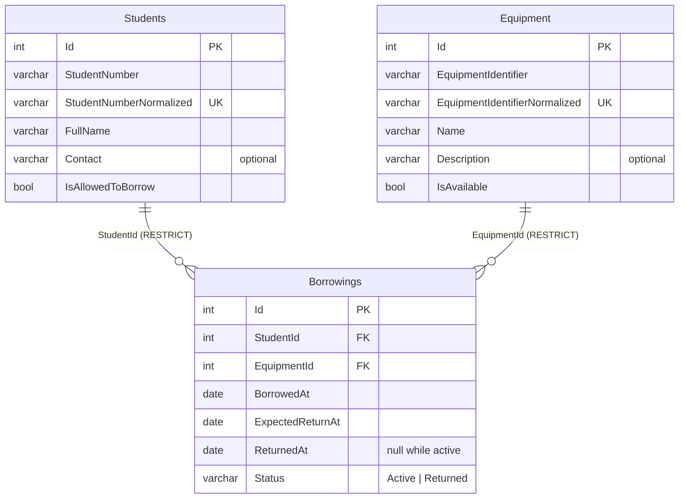

# PostgreSQL schema (as produced by migration `InitialPostgres`)

| Constraint | Purpose |
|---|---|
| `UX_Students_StudentNumberNormalized` (unique) | BR-01 |
| `UX_Equipment_IdentifierNormalized` (unique) | BR-05 |
| `UX_Borrowings_ActiveByEquipment` (unique on `EquipmentId` WHERE `ReturnedAt IS NULL`) | BR-10: one active borrowing per item |
| `CK_Borrowings_DueAfterBorrowed` | BR-11 |
| `CK_Borrowings_StatusMatchesReturn` | Active ⇔ no return date; Returned ⇒ date ≥ checkout (BR-13) |
| `CK_Students_*NotBlank`, `CK_Equipment_*NotBlank` | BR-02, BR-06 |
| FKs `Borrowings → Students/Equipment`, `ON DELETE RESTRICT` | BR-14 |
